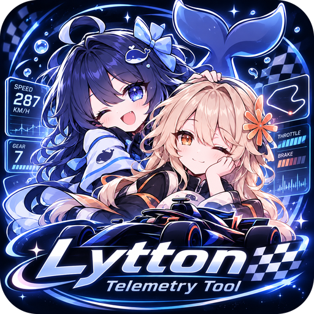

# Lytton Telemetry Tool

<p align="center"></p>

EA SPORTS™ F1® 25 的遥测工作站和 VR 头显仪表。只读取游戏官方 UDP 遥测，用 SteamVR 叠加层在头显里显示排名、赛段、踏板、车况和天气：**不注入游戏、不修改游戏文件**，在线模式（含双人生涯）也能用。

## 功能

- **实时仪表**：排名（相对差距 / 前车间隔 / 领先差距）、赛段与最佳圈差、赛道地图（Track N Race 走线、DRS 区、车手标签）、车辆俯视图（胎温、磨损、损伤）、轮胎与车况、燃油、未来 45 分钟天气预报；全屏地图模式。
- **VR 头显面板**：排名塔、赛段与计时、油门刹车、车辆、车况、天气六块面板，贴合头显可用视野边缘，跟随 SteamVR 帧率刷新。
- **录制与回放**：自动按会话分文件录制（`.f1tr`），闪回时自动截掉作废段；可暂停、拖动、变速回放，任选两圈对比。
- **遥测转发**：内置 hub，把遥测同时转发给其他工具。
- **车辆调校**：调校数据查看。

## 使用

1. 运行安装包 `LyttonTelemetryTool-Setup-<版本>.exe`（装到用户目录，不需要管理员权限；覆盖安装保留设置和录像）。
2. F1 25 → 设置 → 遥测：UDP 开，IP `127.0.0.1`，端口 `20700`，格式 2025。
3. 运行 Lytton Telemetry Tool；要用头显面板就先启动 SteamVR。没有游戏时可用 `--demo` 看虚拟比赛。

版本记录见 [apps/README.md](apps/README.md)，架构见 [docs/ARCHITECTURE.md](docs/ARCHITECTURE.md)。

## 构建

Windows，Qt 6.9.3（MinGW 套件，用 Qt 自带的 GCC 13.1）和 CMake：

```sh
cmake -S . -B build-qt -G "MinGW Makefiles" -DCMAKE_BUILD_TYPE=Release -DCMAKE_CXX_COMPILER=g++ -DCMAKE_RC_COMPILER=windres -DCMAKE_PREFIX_PATH=C:/Qt/6.9.3/mingw_64
cmake --build build-qt -j 8 --target lytton      # build-qt/app/LyttonTelemetryTool.exe
```

测试和旧版 ImGui 窗口用 Qt 自带的 llvm-mingw（`-DCMAKE_TOOLCHAIN_FILE=cmake/llvm-mingw.cmake`，工具链在别处时加 `-DLLVM_MINGW=<目录>`），`ctest --test-dir build`。安装包：`bash scripts/build-installer.sh`（Inno Setup 6）。

## 许可证

代码按 [GPL-3.0](LICENSE) 发布。程序使用了 [Track N Race](https://github.com/NoGoat/Track-N-Race)（作者 NoGoat，GPL-3.0）的赛道地图和赛车图，感谢作者开源；其他第三方组件（Dear ImGui、OpenVR、racetrack-database、f1-circuits、Qt）见 `third_party/` 各目录和安装包里的“许可与第三方组件.txt”。

## 图标与商标声明

- `assets/brand/` 里的鲸鱼娘 logo 和角色形象由作者用 AI 生成，**不在 GPL-3.0 范围内**，保留所有权利：fork 本仓库请换用自己的图标。
- Lytton Telemetry Tool 是非官方的个人项目，与 Formula 1、EA、Codemasters 无关联，也未获其认可。F1、FORMULA 1 及相关标志是 Formula One Licensing B.V. 的商标；EA SPORTS F1 25 是 Electronic Arts 的商标，在此仅用于说明兼容的游戏。
- 开发过程中使用了 Claude（Anthropic）和 DeepSeek 等 AI 工具辅助，在此致谢。
